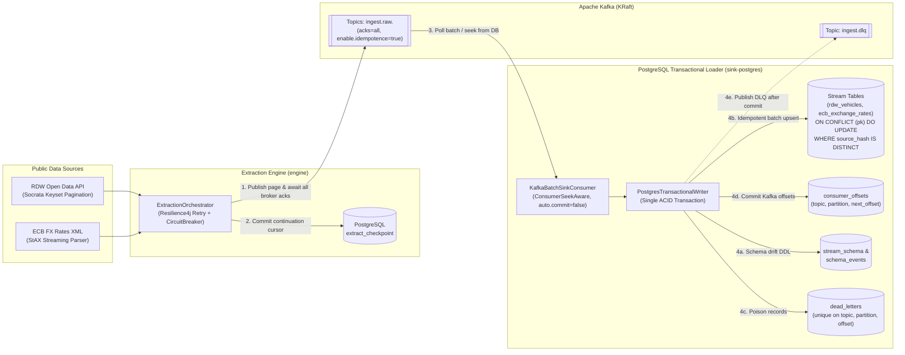

# Resumable Ingestion Pipeline (`ingest-pipeline`)

A Java 21 / Spring Boot 3.3 data ingestion framework (`SourceConnector` SPI) that extracts from paginated HTTP APIs (Dutch RDW Socrata SODA) and XML feeds (European Central Bank FX Reference Rates), buffers through Apache Kafka (`acks=all`, idempotent producer), and loads into PostgreSQL 16 with **transactional offset tracking**, **idempotent source-hash upserts**, **online schema-drift evolution**, **dead-letter routing**, and **crash recovery (`kill -9`)**.

---

## 1. Architecture



---

## 2. Quickstart

```bash
# 1. Start PostgreSQL 16, Apache Kafka (KRaft), Prometheus, and Grafana
docker compose -f deploy/docker-compose.yml up -d

# 2. Run the full unit + Testcontainers integration verification suite
mvn clean verify

# 3. Run the M3 kill-and-resume OS process crash-recovery script (10 consecutive SIGKILL runs)
./scripts/kill-and-resume.sh

# 4. Run the M6 benchmark script to reproduce all throughput, batch-size, and heap numbers
./scripts/benchmark.sh
```

---

## 3. Crash-Recovery & Reliability Proof

| Verification Gate | Test / Script | Verified Behavior |
| :--- | :--- | :--- |
| **Idempotent 200k Replay (M2)** | `M2TransportAndLoaderIT` | Loading 200,000 records twice (`400,000` Kafka messages) produces `200,000` rows, identical MD5 dataset checksums, and `0` redundant row updates (`MAX(loaded_at)` unchanged). |
| **Mid-Sync Crash Recovery (M3)** | `M3CrashRecoveryIT` & `scripts/kill-and-resume.sh` | **0 duplicates and 0 gaps across 10 consecutive runs** with multiple mid-sync crashes injected after Kafka broker acks and before checkpoint commit. |
| **Online Schema Drift & DLQ (M4)** | `M4SchemaDriftAndDlqIT` | Executes `ADD COLUMN` and `INTEGER -> BIGINT -> NUMERIC` widening (with cache rollback eviction) while routing incompatible types and corrupt JSON to `dead_letters` (deduplicated by `(topic, partition, offset)`) and `ingest.dlq`. |
| **Constant-Heap XML & E2E Load (M5)** | `EcbXmlConnectorTest` & `M5EcbEndToEndIT` | Streams a **155 MB** (`3,200,000` records) synthetic ECB XML file inside a **`-Xmx64m`** JVM without `OutOfMemoryError`, and loads `ecb_exchange_rates` end-to-end through Kafka into PostgreSQL. |

---

## 4. Measured Benchmarks

Reproduced via `./scripts/benchmark.sh` on:
- **CPU:** `Intel(R) Core(TM) i3-1005G1 CPU @ 1.20GHz`
- **RAM:** `4.2Gi` (WSL2 Ubuntu 24.04)
- **JDK:** `openjdk version 21.0.12.1 2026-08-18`

### 4.1 End-to-End Pipeline, XML Streaming & Crash Recovery

| Benchmark | Dataset | Heap Limit | Measured Result |
| :--- | :--- | :--- | :--- |
| **RDW JSON End-to-End (`Extract -> Kafka -> PostgreSQL`)** | `20,000` records (`pageSize=2500`) | `-Xmx512m` | **`3788` records/sec** |
| **ECB XML End-to-End (`Extract -> Kafka -> PostgreSQL`)** | `20,000` records (`pageSize=2500`) | `-Xmx512m` | **`5197` records/sec** |
| **ECB XML StAX Parser Extraction (`connector-ecb-xml` only)** | `155 MB` (`3,200,000` records) | `-Xmx64m` | **`560028` records/sec**, Peak Sampled Heap **`27` MB** |
| **Mid-Sync Crash-and-Resume Convergence (`M3`)** | `10,000` records (crash after page 3) | `-Xmx512m` | **`968` ms** |

### 4.2 Effect of Batch Size on PostgreSQL Transactional Upsert Throughput

| Batch Size (`records/tx`) | Dataset | Measured Upsert Throughput |
| :--- | :--- | :--- |
| **`100`** | `10,000` records | **`7012` records/sec** |
| **`500`** | `10,000` records | **`14164` records/sec** |
| **`1000`** | `10,000` records | **`15337` records/sec** |
| **`5000`** | `10,000` records | **`18450` records/sec** |

---

## 5. Architecture Decision Records (ADRs)

- [**ADR-0001: Transactional Offsets in PostgreSQL**](docs/adr/0001-transactional-offsets-in-postgresql.md)
- [**ADR-0002: Keyset Pagination vs. Offset Pagination**](docs/adr/0002-keyset-vs-offset-pagination.md)
- [**ADR-0003: Idempotent Upsert with Canonical Source Hash**](docs/adr/0003-idempotent-upsert-with-source-hash.md)
- [**ADR-0004: Effectively-Once Results Over At-Least-Once Transport**](docs/adr/0004-at-least-once-to-effectively-once.md)
- [**ADR-0005: JDBC Batch Writes Over JPA on the Hot Path**](docs/adr/0005-jdbc-batch-over-jpa.md)

---

## 6. What I Would Change at Scale

1. **PostgreSQL `COPY` Staging & Table Partitioning:** At 100M+ rows per stream, `INSERT ... ON CONFLICT` index maintenance becomes I/O bound. Staging batches into an unlogged temporary table via PostgreSQL `COPY` and merging into hash/range-partitioned target tables reduces B-Tree index thrashing.
2. **Binary Wire Format (Protobuf / Avro):** Replace JSON-encoded `SourceRecord` envelopes on Kafka topics with Schema Registry-backed binary payloads to reduce broker network and disk usage.
3. **Partitioned Keyset Ranges Across Worker Instances:** Split keyset ranges across multiple extractor workers coordinated via PostgreSQL advisory locks (`pg_try_advisory_lock`).
