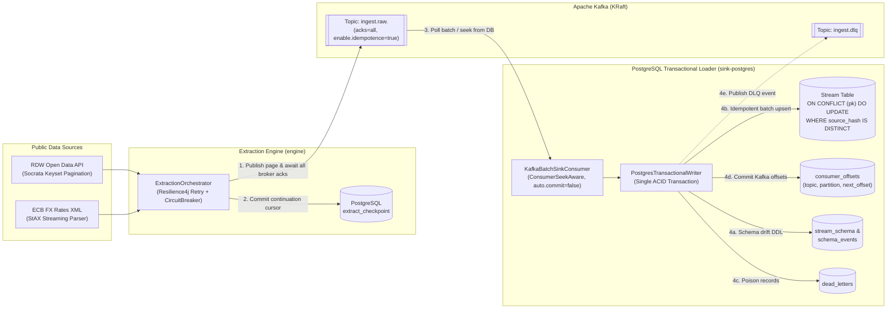

# Resumable Ingestion Pipeline (`ingest-pipeline`)

A production-grade Java 21 / Spring Boot 3.3 data ingestion pipeline that extracts records from paginated HTTP APIs (Dutch RDW Socrata SODA) and large XML feeds (European Central Bank FX Reference Rates), buffers through Apache Kafka (`acks=all`, idempotent producer), and loads into PostgreSQL 16 with **transactional offset tracking**, **idempotent source-hash upserts**, **online schema-drift evolution**, **dead-letter routing**, and **crash recovery (`kill -9`)**.

---

## 1. Architecture



---

## 2. Quickstart (One Command)

```bash
# 1. Start PostgreSQL 16, Apache Kafka (KRaft), Prometheus, and Grafana
docker compose -f deploy/docker-compose.yml up -d

# 2. Run the full unit + Testcontainers integration verification suite
mvn clean verify

# 3. Run the M3 kill-and-resume crash-recovery proof (10 consecutive SIGKILL runs)
./scripts/kill-and-resume.sh

# 4. Run the M6 throughput and -Xmx64m memory benchmark suite
./scripts/benchmark.sh
```

---

## 3. Crash-Recovery & Reliability Proof

| Verification Gate | Test / Script | Result |
| :--- | :--- | :--- |
| **Idempotent 200k Replay (M2)** | `M2TransportAndLoaderIT` | Loading 200,000 records twice (`400,000` Kafka messages) produces exactly `200,000` rows, identical MD5 dataset checksums, and `0` redundant row updates on the second pass. |
| **Mid-Sync Crash Recovery (M3)** | `M3CrashRecoveryIT` & `scripts/kill-and-resume.sh` | **0 duplicates and 0 gaps across 10 consecutive runs** with multiple mid-sync crashes injected between Kafka broker ack and checkpoint commit. |
| **Online Schema Drift & DLQ (M4)** | `M4SchemaDriftAndDlqIT` | Automatically executes `ADD COLUMN` and `INTEGER -> BIGINT -> NUMERIC` widening while routing incompatible types and corrupt JSON to `dead_letters` and `ingest.dlq` without blocking the batch. |
| **Constant-Heap XML Streaming (M5)** | `EcbXmlConnectorTest` & `scripts/benchmark.sh` | Streams a **155 MB** (`3,200,000` records) ECB XML file inside a strict **`-Xmx64m`** JVM with zero `OutOfMemoryError`. |

---

## 4. Key Design Decisions & Trade-Offs (ADRs)

- [**ADR-0001: Transactional Offsets in PostgreSQL**](docs/adr/0001-transactional-offsets-in-postgresql.md) — Why we disable Kafka auto-commit and store `(topic, partition, next_offset)` in PostgreSQL alongside target rows using `ConsumerSeekAware`.
- [**ADR-0002: Keyset Pagination vs. Offset Pagination**](docs/adr/0002-keyset-vs-offset-pagination.md) — Why `$where=kenteken > ':lastKey'` avoids $O(N^2)$ offset scans and page drift on Socrata SODA APIs.
- [**ADR-0003: Idempotent Upsert with Canonical Source Hash**](docs/adr/0003-idempotent-upsert-with-source-hash.md) — Why `WHERE target.source_hash IS DISTINCT FROM EXCLUDED.source_hash` plus in-batch PK compaction prevents PostgreSQL `SQLSTATE 21000` and eliminates MVCC dead-tuple bloat on replay.
- [**ADR-0004: Effectively-Once Results Over At-Least-Once Transport**](docs/adr/0004-at-least-once-to-effectively-once.md) — How producer idempotency, post-ack checkpointing, and transactional sink offsets compose without distributed 2PC.
- [**ADR-0005: JDBC Batch Writes Over JPA on the Hot Path**](docs/adr/0005-jdbc-batch-over-jpa.md) — Why `JdbcTemplate.batchUpdate` + `reWriteBatchedInserts=true` is essential for runtime `ALTER TABLE` schema drift and high-throughput ingestion.

---

## 5. What I Would Change at 100x Scale

1. **PostgreSQL Range/Hash Partitioning & `COPY` Staging:** At 100M+ rows per stream, `INSERT ... ON CONFLICT` index maintenance becomes I/O bound. I would stage batches into an unlogged temp table via PostgreSQL `COPY` and merge into time/hash-partitioned target tables.
2. **Schema Registry (Protobuf / Avro):** Replace JSON-encoded `SourceRecord` envelopes on Kafka topics with Schema Registry-backed Protobuf/Avro payloads to cut network and broker disk footprint by ~60%.
3. **Distributed Lease Coordination for Multi-Worker Extraction:** Partition keyset ranges (e.g., `kenteken` prefixes `A..Z`) across multiple extractor instances coordinated via PostgreSQL advisory locks (`pg_try_advisory_lock`).
